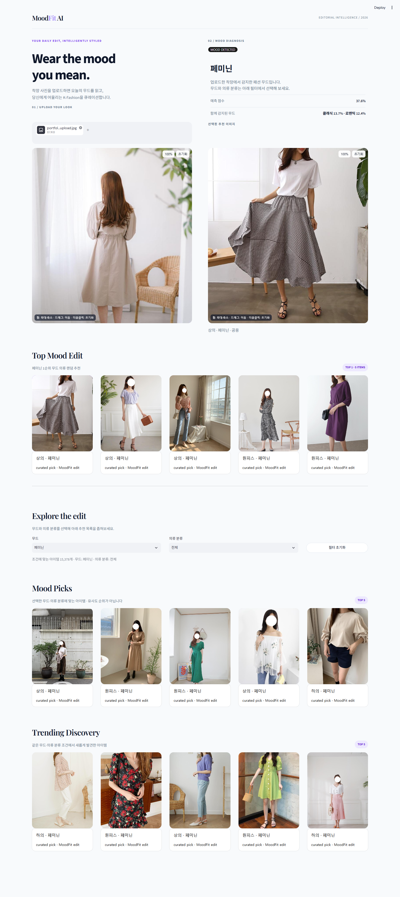
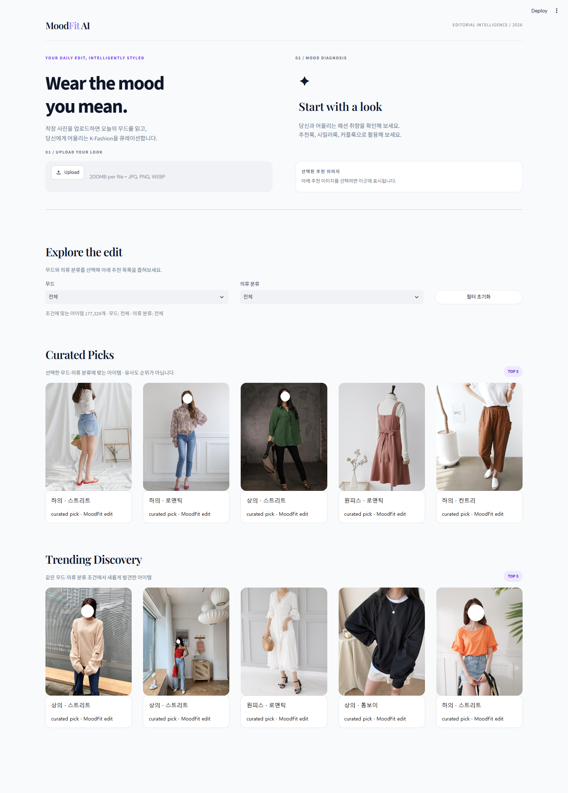
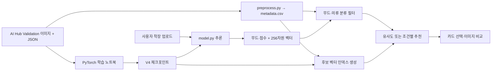

# MoodFit AI

### 착장 한 장에서 시작하는 K-Fashion 스타일 탐색

**이미지 업로드 → 24개 패션 무드 진단 → 조건별 추천 → 이미지 비교**까지 연결한 CNN 기반 패션 큐레이션 웹앱입니다.

원하는 스타일을 검색어로 설명하기 어려운 사용자가 사진으로 탐색을 시작하도록 기획했습니다. ConvNeXt-Tiny 모델 실험부터 AI Hub JSON 전처리, 추천 카탈로그, Streamlit 인터페이스까지 하나의 흐름으로 구현했습니다.

| 개발 영역 | 사용 기술 |
| --- | --- |
| CNN 학습·추론 | Python, PyTorch, TorchVision, ConvNeXt-Tiny, CUDA, AMP |
| 데이터·추천 | pandas, NumPy, scikit-learn, Pillow, JSON bbox, 코사인 유사도 |
| 웹 인터페이스 | Streamlit, HTML/CSS, JavaScript, streamlit-shadcn-ui |
| 저장·검증 | 로컬 캐시, Git LFS, Cloudflare R2 연동, unittest, Streamlit AppTest |

[클라우드 배포](CLOUD_DEPLOYMENT.md) · [실행 가이드](#5-직접-실행하기) · [필수 데이터 준비](#6-github에-없는-자료와-데이터-준비) · [CNN 학습](#7-cnn-모델-학습과-연동) · [테스트](#10-검증과-개선-방향)

## 1. 실제 실행 화면

아래는 **실행 중인 앱에 AI Hub 샘플을 업로드해 직접 캡처한 전체 페이지**입니다. 업로드·진단 영역부터 필터와 마지막 추천 목록까지 포함합니다. 합성한 UI 시안이 아닙니다.

[](docs/images/moodfit-full.png)

*캡처: 2026-11-05 · 시연 이미지 출처: AI Hub K-Fashion 이미지. 화면의 예측 점수는 해당 입력에 대한 모델 출력입니다. 캡처 당시에는 후보 임베딩 인덱스가 없어 `Mood Picks` 방식으로 동작했습니다.*

<details>
<summary>이미지 업로드 전 전체 화면 보기</summary>

[](docs/images/moodfit-initial.png)

</details>

### 사용 흐름

1. **착장 사진 업로드**: JPG·PNG·WEBP 이미지를 입력합니다.
2. **무드 진단 확인**: 가장 높은 무드와 예측 점수, 그다음 무드들을 확인합니다.
3. **추천 착장 비교**: 첫 추천이 자동 선택되며, 다른 카드를 누르면 우측 이미지가 바뀝니다.
4. **조건 좁히기**: 무드와 의류 분류를 함께 선택합니다. 결과 개수 확인과 초기화를 지원합니다.
5. **이미지 자세히 보기**: 좌우 이미지에서 휠 확대·축소, 드래그 이동, 더블클릭 초기화를 사용할 수 있습니다.

## 2. 기획: 검색어 대신 사진으로 시작하기

### 해결하려는 문제

패션 추천에서 사용자는 자신이 원하는 분위기를 정확한 스타일명으로 설명하기 어렵습니다. 분류 결과만 보여주는 모델 데모를 넘어, **사용자가 결과를 확인하고 다른 착장과 비교하며 탐색을 이어갈 수 있는 화면**이 필요했습니다.

### 기획을 구현으로 연결한 선택

| 사용자 문제 | 서비스 설계 | 구현 근거 |
| --- | --- | --- |
| 스타일 이름을 몰라 검색을 시작하기 어렵다 | 사진 업로드를 진입점으로 삼고 예측 무드를 기본 탐색 조건으로 연결 | [`app.py`](app.py), [`model.py`](model.py) |
| 무드 이름 하나만으로 결과를 이해하기 어렵다 | 무드별 점수와 추천 이미지를 함께 제시 | `analyze_image`, `render_analysis_panel` |
| 추천 이미지를 하나씩 자세히 비교하고 싶다 | 첫 추천 자동 선택, 카드 클릭 전환, 좌우 독립 줌·드래그 | `ensure_selected_recommendation`, `render_interactive_image` |
| 필터를 바꿔도 왜 결과가 나오는지 알기 어렵다 | 무드·의류 분류의 교집합 적용, 결과 개수, 초기화, 결과 없음 안내 | `catalog_filter_options`, `filter_catalog` |
| 데이터에 없는 정보를 필터로 오해할 수 있다 | 실질적인 성별 라벨이 없는 현재 카탈로그에서는 성별 선택을 숨김 | [`preprocess.py`](preprocess.py), [`PRD.md`](PRD.md) |

입력한 착장을 기준으로 스타일을 탐색하는 서비스이며, 사용자 이력을 학습하는 개인화는 향후 확장 대상으로 두었습니다.

## 3. CNN 개발: 학습 실험을 웹 추론으로 연결

### 모델 구조

[ConvNeXt-Tiny](https://docs.pytorch.org/vision/stable/models/generated/torchvision.models.convnext_tiny.html)의 ImageNet 사전학습 가중치를 출발점으로 사용하는 **CNN 전이학습**입니다.

```text
RGB 이미지
  → 224 × 224 Resize / ImageNet Normalize
  → ConvNeXt-Tiny 특징 추출
  → Global Average Pooling
  → Flatten → Linear(768, 256) → ReLU → Dropout(0.3)
  → Linear(256, 24)
  → 무드별 확률
```

분류층 직전의 **256차원 특징 벡터**도 함께 추출해 L2 정규화합니다. 무드 진단과 이미지 유사도 검색을 위한 출력을 한 번의 순전파에서 얻습니다. 추론에는 `eval()`과 `torch.inference_mode()`를 적용했습니다.

### V4 실험에서 다룬 문제

| 문제 | 적용한 접근 |
| --- | --- |
| 클래스별 데이터 수 차이 | 클래스 비율을 유지한 80:20 분할 후, **학습 파트의 스트리트 클래스만 최대 10,000장**으로 제한 |
| 사전학습 특징의 도메인 적응 | ConvNeXt의 마지막 3개 feature 모듈을 미세조정 |
| 과도한 가중치 변화 | backbone `3e-6`, classifier `1e-4`의 서로 다른 AdamW 학습률 적용 |
| 이미지 변화에 대한 대응 | 학습 데이터에 좌우 반전·작은 회전/이동·밝기/대비 증강 적용 |
| GPU 메모리·연산 비용 | CUDA AMP와 GradScaler, 고정 메모리 DataLoader 사용 |
| 정확도만으로 소수 클래스 성능을 판단하기 어려움 | Accuracy와 함께 **Macro F1·Balanced Accuracy** 기록, Macro F1 최고 모델 저장 |

실험 코드는 [`CNN_model_PyTorch4.ipynb`](CNN_model_PyTorch4.ipynb)에 있습니다. V2·V3·V4 노트북과 [`Model/`](Model/)의 학습 로그로 실험 변경 내용을 확인할 수 있습니다.

### 현재 검증 결과와 해석

저장된 [V4 학습 로그](Model/v4_street_cap_10000_more_layers_training_log.txt)의 최고 Macro F1 기록은 다음과 같습니다.

| 로그 기준 | Validation Accuracy | Macro F1 | Balanced Accuracy |
| --- | ---: | ---: | ---: |
| Epoch 12 | 48.36% | 0.2063 | 21.22% |

**이 수치는 프로젝트 내부 80:20 분할의 검증 결과**입니다. 이 프로젝트는 AI Hub의 `Validation` 자료를 내려받아 다시 학습·검증으로 나누어 사용했습니다. 따라서 위 수치를 독립적인 공식 테스트셋 성능으로 제시하지 않습니다.

Accuracy와 균형 지표의 차이가 남아 있어 클래스별 오류 분석과 불균형 대응을 계속 개선할 필요가 있습니다. 현재 결과와 로그를 함께 공개해 실험의 근거를 확인할 수 있도록 했습니다.

## 4. 웹 개발: 모델 출력에서 사용 가능한 탐색 도구로

### 분류와 추천을 구분한 파이프라인

- **Top Mood Edit**: 진단된 1순위 무드에 해당하는 카탈로그 항목을 제시합니다.
- **AI Similarity**: 현재 모델·카탈로그와 일치하는 후보 인덱스가 있으면 코사인 유사도로 순위를 계산합니다.
- **Mood Picks / Curated Picks**: 인덱스가 없으면 선택한 무드·의류 분류 안에서 추천합니다. 화면에도 유사도 순위가 아님을 표시합니다.
- **Trending Discovery**: 같은 필터 조건에서 앞선 추천과 중복되지 않는 아이템을 제시합니다. 현재 명칭의 `Trending`은 실제 판매·인기 순위를 뜻하지 않습니다.

### 구현에서 신경 쓴 부분

| 항목 | 구현 내용 |
| --- | --- |
| 데이터와 화면 분리 | 원본 이미지 전체를 메모리에 올리는 대신 경량 CSV를 기준으로 탐색 |
| 화면용 캐시 | 필요한 전신 썸네일·bbox 크롭을 렌더링 시 생성하고 재사용 |
| 반복 추론 감소 | 모델 로딩 캐시와 업로드·체크포인트 기반 분석 결과 재사용 |
| 잘못된 인덱스 방지 | 모델 SHA-256, 카탈로그 fingerprint, 벡터 checksum·shape 확인 |
| 필터 정확성 | 조건 밖 항목으로 결과를 채우지 않고, 빈 결과를 명시 |
| 결과 비교 | 카드 선택 시 업로드를 유지하고, 각 이미지의 줌·드래그를 별도 iframe에서 처리 |
| 배포 확장 | 로컬 파일과 R2 공개 URL을 함께 지원하고, 비밀키를 별도 설정으로 분리 |



## 5. 직접 실행하기

### 권장 환경

- Python **3.12**, Windows PowerShell 기준
- GPU 환경: PyTorch **2.6.0**, TorchVision **0.21.0**, CUDA **12.4 wheel**
- CNN 학습에는 CUDA GPU가 필요합니다. 웹 추론은 CUDA가 없으면 CPU를 사용합니다.
- `requirements.txt`의 `numpy<2` 설정 때문에 Python 3.14 환경 대신 **Python 3.12 가상환경**을 사용합니다.

### 5-1. 저장소와 패키지 준비

Git과 Git LFS가 설치되어 있어야 합니다. 아래 명령은 프로젝트를 저장할 로컬 폴더에서 실행합니다.

```powershell
git lfs install
git clone https://github.com/hamhj7694/CNN-FashionStyle.git
cd CNN-FashionStyle
git lfs pull

py -3.12 -m venv .venv
& .\.venv\Scripts\python.exe -m pip install --upgrade pip
& .\.venv\Scripts\python.exe -m pip install -r requirements-pytorch-gpu.txt
```

<details>
<summary>GPU 없이 웹 추론만 실행하는 경우</summary>

위 GPU 패키지 설치 명령 대신 다음 명령을 사용합니다.

```powershell
& .\.venv\Scripts\python.exe -m pip install -r requirements.txt
& .\.venv\Scripts\python.exe -m pip install torch==2.6.0 torchvision==0.21.0 --index-url https://download.pytorch.org/whl/cpu
```

학습 노트북은 GPU 필수 설정이므로 이 환경에서는 웹 추론과 데이터 전처리를 사용합니다.

</details>

### 5-2. 실행 전 필요한 자료 확인

아래 데이터와 가중치 안내를 먼저 확인하세요. **Git clone만으로 원본 추천 이미지까지 준비되지는 않습니다.** CSV가 있어도 해당 이미지 파일 또는 공개 URL이 없으면 추천 사진을 표시할 수 없습니다.

```powershell
& .\.venv\Scripts\python.exe -m streamlit run app.py
```

브라우저에서 [http://localhost:8501](http://localhost:8501)을 엽니다. 종료는 실행 터미널에서 `Ctrl+C`입니다.

## 6. GitHub에 없는 자료와 데이터 준비

### 6-1. 무엇이 별도로 필요한가?

| 자료 | 현재 저장소 상태 | 준비 방법 |
| --- | --- | --- |
| AI Hub 원본 JPG·JSON | `CNN_train_test/`는 Git 제외 대상 | **AI Hub K-Fashion의 Validation 이미지와 JSON을 직접 다운로드** |
| `recommend_pool/metadata.csv` | Git에 포함 | 이미지 목록과 상대 경로를 담은 CSV이며 이미지 자체는 포함하지 않음 |
| 기본 V4 `.pth` | 현재 **Git LFS로 추적** | `git lfs pull`로 실제 가중치 확보. 추가 실험 가중치는 별도 준비 |
| ImageNet 사전학습 가중치 | 저장소 외부 TorchVision 캐시 | 최초 학습 모델 생성 시 다운로드 |
| 화면용 썸네일·크롭 | `processed_crops/`의 생성물은 Git 제외 | 원본과 CSV 준비 후 앱에서 필요할 때 생성 |
| 후보 임베딩 `.npy`와 검증 `.json` | 별도 생성 필요 | 아래 `model.py --build-index` 실행 |
| R2 비밀 설정 | `.streamlit/secrets.toml`은 Git 제외 | R2를 사용할 때만 예제 파일을 복사해 별도 입력 |

### 6-2. AI Hub에서 Validation 자료 다운로드

이 프로젝트에서 사용한 원본은 **[AI Hub — K-Fashion 이미지](https://www.aihub.or.kr/aihubdata/data/view.do?currMenu=115&dataSetSn=51&topMenu=100)** 입니다.

AI Hub에서 로그인·이용 신청 등 안내되는 절차를 완료한 뒤, 다운로드 목록에서 다음 **두 자료를 모두** 받습니다.

```text
014.KFashion
└── 01.데이터
    └── 2.Validation
        ├── 원천데이터_modify / 원천데이터.zip     ← 이미지
        └── 라벨링데이터_modify / 라벨링데이터.zip ← JSON 라벨
```

*자료명·제공 방식은 AI Hub에서 확인하세요. 이 프로젝트 재현에 필요한 출발 자료는 위 Validation 원천 이미지와 라벨입니다. 다운로드·이용·재배포는 해당 데이터의 이용 조건을 따릅니다.*

### 6-3. 압축 해제 후 프로젝트 폴더 구조

이미지와 JSON을 **각각 분리하되, 두 폴더 안의 무드명과 파일 ID를 유지**합니다.

```text
CNN-FashionStyle/
├── CNN_train_test/                         # 직접 준비하는 데이터
│   ├── CNN_train_test_image/
│   │   ├── 클래식/
│   │   │   └── 1000115.jpg
│   │   ├── 모던/
│   │   │   └── <이미지ID>.jpg
│   │   └── <나머지 무드 폴더>/
│   └── CNN_train_test_label/
│       ├── 클래식/
│       │   └── 1000115.json
│       ├── 모던/
│       │   └── <동일한 이미지ID>.json
│       └── <나머지 무드 폴더>/
├── Model/
│   └── fashion_mood_model_pytorch4_street_cap_10000_more_layers_best.pth
├── recommend_pool/
│   ├── metadata.csv
│   └── processed_crops/                    # 앱이 생성하는 캐시
├── .streamlit/
│   └── secrets.toml.example
├── app.py
├── model.py
├── preprocess.py
├── curation.py
└── CNN_model_PyTorch4.ipynb
```

**폴더 구성 시 확인할 점**

- `CNN_train_test_image` 바로 아래에 무드 폴더가 있어야 합니다. 압축 폴더가 한 단계 더 끼어들지 않게 확인합니다.
- TorchVision `ImageFolder`가 바로 아래 폴더 이름을 클래스로 읽습니다. 학습과 추론의 클래스 순서를 동일하게 유지합니다.
- `클래식/1000115.jpg`와 `클래식/1000115.json`처럼 ID를 맞춥니다. JSON 내부의 원래 쇼핑몰 파일명과 현재 JPG의 숫자 파일명이 다를 수 있어 전처리에서 JSON stem을 우선 사용합니다.
- 현재 카탈로그 기준 **120,975개 원본 이미지 경로 / 177,329개 annotation 행 / 24개 무드**를 확인했습니다. 이미지 하나에 의류 bbox가 여러 개이면 CSV 행도 여러 개가 됩니다.

### 6-4. JSON을 추천 CSV로 변환

프로젝트 루트에서 실행합니다. 이미 다운로드한 자료의 경로가 위 구조와 다르면 옵션에 실제 경로를 지정합니다.

```powershell
& .\.venv\Scripts\python.exe preprocess.py --json-dir CNN_train_test/CNN_train_test_label --image-dir CNN_train_test/CNN_train_test_image --output recommend_pool/metadata.csv
```

CSV의 주요 컬럼은 다음과 같습니다.

| 컬럼 | 용도 |
| --- | --- |
| `id` | annotation 단위 아이템 식별자 |
| `original_img_path` | 원본 이미지 경로 |
| `original_json_path` | 원본 JSON 경로 |
| `mood` | 무드 폴더명에 기반한 탐색 조건 |
| `category`, `category_detail` | 의류 분류 |
| `bbox` | `[x1, y1, x2, y2]` 형태의 크롭 영역 |
| `gender` | 보존된 메타데이터. 누락값의 기본값도 `공용`이므로 현재 성별 필터에는 사용하지 않음 |

전처리는 원본을 크롭하지 않습니다. 이미지에 접근할 수 없는 JSON은 제외되므로 생성 행이 0개이면 폴더 깊이와 JPG·JSON ID 대응부터 확인합니다.

### 6-5. 로컬 추천이 표시되기 위한 조건

앱의 카탈로그 선택 우선순위는 다음과 같습니다.

```text
recommend_pool/metadata_web.csv
→ recommend_pool/metadata_r2.csv
→ recommend_pool/metadata.csv
→ 프로젝트 루트 metadata.csv
```

존재하는 파일 중 가장 앞의 파일을 사용합니다. 앞 순위에 오래된 CSV가 있으면 방금 생성한 `metadata.csv`가 선택되지 않을 수 있습니다.

로컬 실행에서는 선택된 CSV의 `original_img_path`로 이미지에 접근할 수 있어야 합니다. 상대 경로의 기준은 프로젝트 루트입니다. **다른 PC에서 CSV만 복사한 경우**, 원본 이미지도 같은 상대 경로로 준비하거나 공개 이미지 URL이 있는 카탈로그를 제공해야 합니다.

### 6-6. 웹 배포용 WebP 이미지 준비

원본 학습 이미지를 보존하고, 웹에서는 긴 변 최대 **1,280px / WebP quality 80** 사본을 사용할 수 있습니다. 전체 **120,975장**을 처리한 결과 **7.59 GB → 4.90 GB (35.46% 감소)**로 최적화했으며, 읽지 못한 이미지는 없었습니다. 용량은 10진 GB 기준입니다. 중복된 원본 경로는 한 번만 변환하고, 중단 후 같은 명령으로 완료 파일을 재사용합니다.

```powershell
& .\.venv\Scripts\python.exe prepare_web_images.py --workers 8
& .\.venv\Scripts\python.exe upload_web_images.py --dry-run
```

실제 R2 연결과 업로드, 별도 **CPU용 Streamlit Cloud entrypoint**는 [클라우드 배포 가이드](CLOUD_DEPLOYMENT.md)를 따릅니다. 이 이미지 준비 경로는 현재 화면에서 사용하는 전신 WebP를 생성하며 원본 JPG·JSON은 변경하지 않습니다.

## 7. CNN 모델 학습과 연동

### 기본 체크포인트

앱이 기본으로 읽는 파일은 다음 경로입니다.

```text
Model/fashion_mood_model_pytorch4_street_cap_10000_more_layers_best.pth
```

현재 이 파일은 `.gitattributes`의 Git LFS 추적 대상입니다. 다운로드가 되지 않았다면 다음을 실행합니다.

```powershell
git lfs pull
git lfs ls-files
```

모델 파일이 작은 텍스트이며 `version https://git-lfs.github.com/spec/v1`로 시작하면 실제 가중치 대신 LFS 포인터만 받은 상태입니다. 임의로 확장자를 바꾸지 말고 실제 LFS 객체를 내려받습니다.

### V4를 처음 학습하는 순서

프로젝트 루트에서 Jupyter를 열고 Python 3.12 가상환경 커널을 선택합니다.

```powershell
& .\.venv\Scripts\python.exe -m ipykernel install --user --name moodfit-pytorch --display-name "Python (MoodFit PyTorch GPU)"
& .\.venv\Scripts\python.exe -m jupyter notebook
```

[`CNN_model_PyTorch4.ipynb`](CNN_model_PyTorch4.ipynb)는 **이어 학습 셀이 앞쪽에 배치되어 있으므로 `Run All` 대신 아래 역할 순서로 실행**합니다.

1. `import copy`로 시작하는 **모듈·시드·CUDA 준비 셀**
2. `dataset_path`로 시작하는 **데이터 분할·DataLoader 셀**
3. `weights = models.ConvNeXt_Tiny_Weights.DEFAULT`로 시작하는 **모델·손실·optimizer 셀**
4. `epochs = 100`으로 시작하는 **새 학습 셀**
5. 저장된 로그를 읽는 **그래프 셀**

이미 체크포인트와 학습 로그가 있다면 준비 1~3단계 후 `# V4 이어 학습` 셀을 실행합니다. 새 학습 셀과 이어 학습 셀을 연달아 실행하지 않습니다. Windows/Jupyter에서 worker 문제가 발생하면 노트북의 `workers`를 `0`으로 바꿉니다.

### 다른 가중치를 웹앱에 연결할 때

- ConvNeXt-Tiny와 위의 `768 → 256 → 클래스 수` 분류기 구조를 맞춥니다.
- 학습의 전처리와 `model.py`의 추론 전처리를 일치시킵니다.
- 클래스 순서를 함께 저장합니다. 현재 순서는 `model.py`의 `CLASS_NAMES`에서 확인할 수 있습니다.
- 가중치와 모델 구조·클래스 순서가 다르면 기존 파일을 이름만 바꿔 사용하지 않습니다.

권장 저장 형태:

```python
torch.save({
    "model_state_dict": mood_model.state_dict(),
    "class_names": full_dataset.classes,
}, "Model/fashion_mood_model_pytorch4_street_cap_10000_more_layers_best.pth")
```

현재 로더는 bare `state_dict`와 `state_dict` / `model_state_dict` 키가 있는 checkpoint를 지원합니다. 단일 사진 추론은 다음 명령으로 확인합니다.

```powershell
& .\.venv\Scripts\python.exe model.py --image "path/to/outfit.jpg"
```

`CNN_model.ipynb`는 TensorFlow 실험 파일이고, 현재 웹앱 추론은 PyTorch V4 구조를 사용합니다. 다른 실험 노트북의 분류기와 혼동하지 않도록 확인합니다.

## 8. 이미지 유사도 추천 인덱스 만들기

조건별 추천은 CSV와 원본만으로 실행할 수 있습니다. **코사인 유사도 순위가 필요하면** 웹 추천 후보의 벡터를 먼저 생성합니다. 전체 자료는 처리 시간이 길 수 있어 시연에는 후보를 선정한 작은 카탈로그부터 시작하는 것을 권장합니다.

```powershell
& .\.venv\Scripts\python.exe model.py --build-index recommend_pool/metadata.csv --device cpu
```

생성 파일:

```text
recommend_pool/item_embeddings_web.npy   # CSV 행 순서와 대응하는 256차원 벡터
recommend_pool/item_embeddings_web.json  # 모델·카탈로그·벡터 검증 정보
```

앱에서 실제 사용하는 CSV를 `--build-index`에 지정해야 합니다. 모델, 후보 목록 또는 행 순서를 바꾸면 인덱스를 다시 생성합니다. 다른 PC에는 `.npy`와 검증 `.json`을 함께 전달합니다.

## 9. 선택 사항: Cloudflare R2로 이미지 제공

로컬 원본 이미지를 사용할 때는 R2 설정이 필요하지 않습니다. 원본 폴더를 배포 서버에 두기 어려운 경우 R2 공개 URL이 있는 카탈로그를 준비할 수 있습니다.

```powershell
Copy-Item .streamlit/secrets.toml.example .streamlit/secrets.toml
```

생성한 파일에 `R2_ACCOUNT_ID`, `R2_ACCESS_KEY_ID`, `R2_SECRET_ACCESS_KEY`, `R2_BUCKET_NAME`, `R2_PUBLIC_BASE_URL`을 입력합니다. 실제 키는 Git에 커밋하지 않습니다.

먼저 소량 dry run으로 로컬 이미지와 크롭 생성 경로를 확인합니다.

```powershell
& .\.venv\Scripts\python.exe upload_crops_to_r2.py --metadata recommend_pool/metadata.csv --output recommend_pool/metadata_r2_preview.csv --limit 10 --dry-run
```

dry run에도 미리보기 CSV가 생성되므로, 앱의 우선순위 카탈로그와 겹치지 않는 `metadata_r2_preview.csv`에 저장합니다. 실제 업로드는 결과와 설정을 확인한 뒤 실행합니다.

```powershell
& .\.venv\Scripts\python.exe upload_crops_to_r2.py --metadata recommend_pool/metadata.csv --output recommend_pool/metadata_r2.csv
```

`metadata_r2.csv`에는 전신 이미지 `full_image_url`과 크롭 `image_url`이 추가됩니다. 공개 URL이 실제로 열려야 브라우저에서 이미지가 표시됩니다. 앱이 R2 버킷 목록을 자동으로 다운로드하는 구조는 아니므로 **URL이 들어 있는 CSV도 배포**해야 합니다. 새 CSV로 유사도 추천까지 사용한다면 그 CSV를 기준으로 인덱스도 생성합니다.

## 10. 검증과 개선 방향

### 실행 가능한 검증

```powershell
& .\.venv\Scripts\python.exe -m unittest discover -s tests -v
```

웹 배포 준비 기준 **23개 테스트**를 통과했습니다. 실제 ConvNeXt 구조를 사용하는 임시 가중치 테스트와 Streamlit AppTest를 포함합니다.

- 모델 저장·복원과 이미지 입력 형식별 추론 일치
- 후보 인덱스 checksum·모델·카탈로그 검증
- 중복 ID·비연속 index가 있는 카탈로그의 유사도 행 매핑
- 무드·의류 분류 조합, 결과 0개, 초기화
- 새 업로드의 기본 무드, 수동 필터 유지, 이미지 제거·빈 데이터 처리

### 다음 개선 과제

1. **평가 분리**: 학습에 사용하지 않은 독립 데이터로 최종 평가하고 클래스별 오류·혼동행렬 공개
2. **불균형 대응 비교**: 샘플 제한 외에 가중 손실·샘플러 등을 동일한 검증 조건에서 비교
3. **추천 평가**: 분류 지표와 별도로 추천 적합도와 사용자 선택 행동을 평가
4. **배포 재현성**: 데이터 버전·분할 목록·모델·인덱스를 함께 버전 관리

### 코드·문서 길잡이

| 파일 | 역할 |
| --- | --- |
| [`app.py`](app.py) | 업로드·진단·필터·선택 이미지·줌/드래그 UI |
| [`model.py`](model.py) | 체크포인트 로딩·무드 추론·특징 벡터·인덱스 생성 |
| [`curation.py`](curation.py) | 조건 필터·코사인 유사도·중복 제거·이미지 캐시 |
| [`preprocess.py`](preprocess.py) | AI Hub JSON 해석·bbox 변환·상대 경로 CSV 생성 |
| [`CNN_model_PyTorch4.ipynb`](CNN_model_PyTorch4.ipynb) | V4 CUDA 학습·이어 학습·평가 로그 |
| [`upload_crops_to_r2.py`](upload_crops_to_r2.py), [`r2_storage.py`](r2_storage.py) | 크롭·썸네일 업로드·R2 URL 카탈로그 |
| [`prepare_web_images.py`](prepare_web_images.py), [`upload_web_images.py`](upload_web_images.py) | 재개 가능한 WebP 최적화·R2 업로드 |
| [`deploy/streamlit_app.py`](deploy/streamlit_app.py) | CPU 클라우드 실행 entrypoint |
| [`tests/`](tests/) | 필터와 모델·웹 연동 회귀 테스트 |
| [`PRD.md`](PRD.md) | 기획·데이터 계약·기능 요구사항 |

---

데이터 출처: [AI Hub K-Fashion 이미지](https://www.aihub.or.kr/aihubdata/data/view.do?currMenu=115&dataSetSn=51&topMenu=100). 원본 데이터와 시연 이미지의 이용 조건은 제공처 안내를 확인하세요.
